# Mirai Dropdown Menu

[](https://pub.dev/packages/mirai_dropdown_menu)
[](https://flutter.dev)
[](https://dart.dev)
[](LICENSE)

A **generic, zero-dependency dropdown menu widget** for Flutter with built-in search, keyboard-aware smart positioning, animated transitions, and an optional free-text "Other" field.

## MiraiDevs <contact@miraidevs.com>

---

## ✨ Features

- 🎯 **Generic typing** — Works with `String`, custom models, or any type `<T>`
- 🔍 **Built-in search** — Filter items with an integrated search field
- 📝 **"Other" text field** — Let users enter custom values not in the list
- 📱 **Keyboard-aware** — Auto-repositions when the keyboard appears
- 🧭 **Smart positioning** — Detects screen overflow and auto-switches to top mode
- 🎬 **Animated transitions** — Smooth open/close with `SizeTransition` + `Opacity`
- 📦 **Zero dependencies** — Only depends on Flutter SDK
- ⚡ **Programmatic control** — Open the dropdown via `GlobalKey`

---

## 📸 Preview

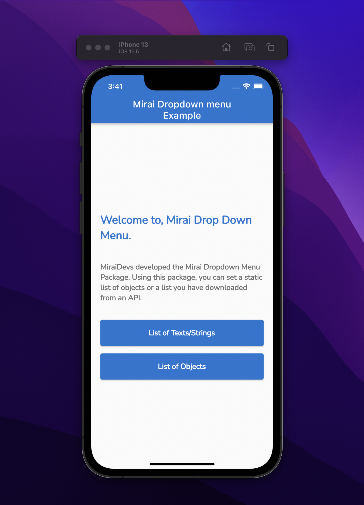
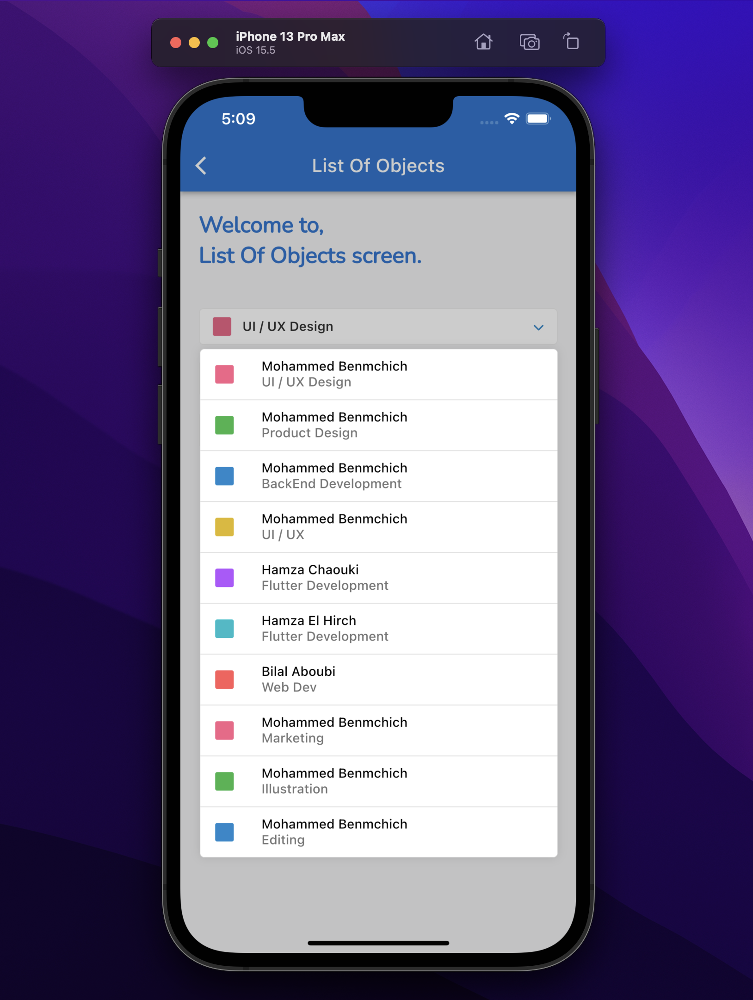

---

## 🏗️ Architecture

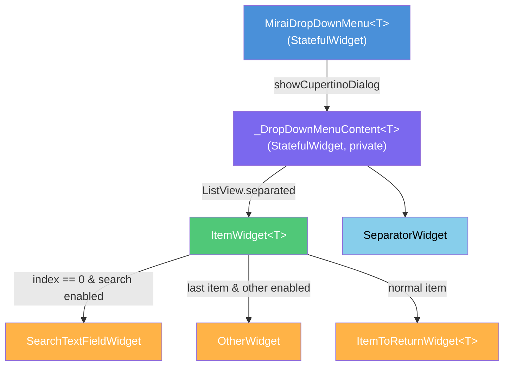

### How It Works

1. **`MiraiDropDownMenu<T>`** wraps your `child` widget in a `GestureDetector`.
2. On tap, it calculates the child's screen position via `RenderBox` and opens a **full-screen `showCupertinoDialog`**.
3. Inside the dialog, **`_DropDownMenuContent`** renders a `Stack` with a `Positioned` overlay aligned to the trigger.
4. The overlay is animated with `SizeTransition` + `Opacity` via an `AnimationController`.
5. A `ListView.separated` renders items, optionally prepending a search field and appending an "Other" text field.
6. Smart positioning logic detects screen overflow and auto-switches to `MiraiShowMode.top`.

---

## 📦 Dependency Graph

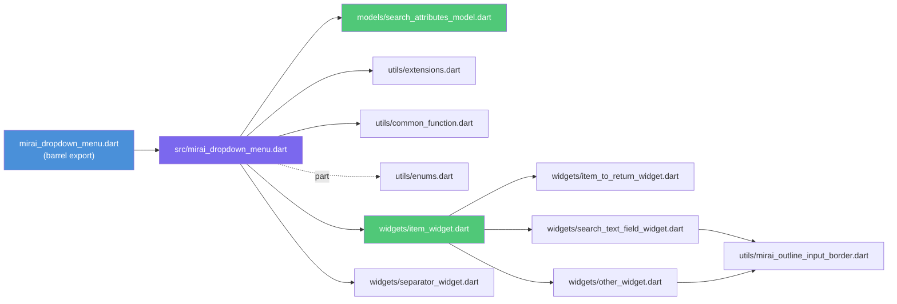

---

## 📂 File Structure

```
lib/
├── mirai_dropdown_menu.dart              # Barrel export
└── src/
    ├── mirai_dropdown_menu.dart           # Core widget (4 classes)
    ├── models/
    │   └── search_attributes_model.dart   # SearchAttributes<T>
    ├── utils/
    │   ├── enums.dart                     # MiraiPopupMenuMode, MiraiShowMode, MiraiExit
    │   ├── common_function.dart           # miraiPrint(), safeGet()
    │   ├── extensions.dart                # BuildContext & int extensions
    │   └── mirai_outline_input_border.dart # Input border helper
    └── widgets/
        ├── item_widget.dart               # Item routing (search/other/normal)
        ├── item_to_return_widget.dart      # Tappable item with ElevatedButton
        ├── search_text_field_widget.dart   # Search TextFormField
        ├── other_widget.dart              # "Other" free-text TextFormField
        └── separator_widget.dart          # 1px divider
```

---

## 🚀 Installation

Add `mirai_dropdown_menu` to your `pubspec.yaml`:

```yaml
dependencies:
  mirai_dropdown_menu: <latest_version>
```

Then import it:

```dart
import 'package:mirai_dropdown_menu/mirai_dropdown_menu.dart';
```

---

## 📖 API Reference

### Enums

| Enum | Values | Purpose |
|---|---|---|
| `MiraiPopupMenuMode` | `popupMenu`, `dropDownMenu` | Display mode |
| `MiraiShowMode` | `top`, `bottom` | Direction the dropdown opens |
| `MiraiExit` | `fromAll`, `outside`, `inside` | Controls what taps close the dropdown |

### Type Definitions

| Typedef | Signature |
|---|---|
| `MiraiDropdownBuilder<T>` | `Widget Function(int index, T? item, {bool isItemSelected})` |
| `MiraiHighLightDropdownBuilder<T>` | `Widget Function(int index, SearchAttributes<T> item)` |
| `MiraiValueChanged<T>` | `void Function(T value)` |

### `MiraiDropDownMenu<T>` — Key Parameters

| Parameter | Type | Default | Description |
|---|---|---|---|
| `child` | `Widget` | **required** | Trigger widget (must have a `GlobalKey`) |
| `children` | `List<T>` | **required** | Items to display |
| `itemWidgetBuilder` | `MiraiDropdownBuilder<T>` | **required** | Builds each item row |
| `onChanged` | `ValueChanged<T>?` | `null` | Called when an item is selected |
| `valueNotifier` | `ValueNotifier<T>?` | `null` | Tracks the selected item |
| `showMode` | `MiraiShowMode` | `bottom` | Open direction |
| `exit` | `MiraiExit` | `fromAll` | Close behavior |
| `showSearchTextField` | `bool` | `false` | Show built-in search |
| `showOtherAndItsTextField` | `bool` | `false` | Show "Other" text input |
| `maxHeight` | `double?` | `null` | Cap the dropdown height |
| `enable` | `bool` | `true` | Enable/disable the trigger |
| `showSeparator` | `bool` | `true` | Show dividers between items |
| `space` | `double` | `3` | Gap between trigger and dropdown |

### Programmatic Control

```dart
GlobalKey<MiraiDropDownMenuState<String?>> dropdownKey = GlobalKey();
// Open programmatically:
dropdownKey.currentState?.showDropDownMenu();
```

---

## 💡 Usage

### 1. Create a Dropdown Widget

```dart
class MiraiDropdownWidget<String> extends StatelessWidget {
  const MiraiDropdownWidget({
    Key? key,
    required this.valueNotifier,
    required this.itemWidgetBuilder,
    required this.children,
    required this.onChanged,
    this.underline = false,
    this.showSeparator = true,
    this.exit = MiraiExit.fromAll,
    this.chevronDownColor,
    this.showMode = MiraiShowMode.bottom,
    this.maxHeight,
    this.showSearchTextField = false,
    this.showOtherAndItsTextField = false,
    this.other,
  }) : super(key: key);

  final ValueNotifier<String> valueNotifier;
  final MiraiDropdownBuilder<String> itemWidgetBuilder;
  final List<String> children;
  final ValueChanged<String> onChanged;
  final bool underline;
  final bool showSeparator;
  final MiraiExit exit;
  final Color? chevronDownColor;
  final MiraiShowMode showMode;
  final double? maxHeight;
  final bool showSearchTextField;
  final bool showOtherAndItsTextField;
  final Widget? other;

  @override
  Widget build(BuildContext context) {
    return MiraiDropDownMenu<String>(
      key: UniqueKey(),
      enable: true,
      space: 4,
      showMode: showMode,
      exit: exit,
      showSeparator: showSeparator,
      children: children,
      itemWidgetBuilder: itemWidgetBuilder,
      onChanged: onChanged,
      maxHeight: maxHeight,
      showOtherAndItsTextField: showOtherAndItsTextField,
      showSearchTextField: showSearchTextField,
      other: other,
      child: Container(
        key: GlobalKey(),
        padding: const EdgeInsets.symmetric(horizontal: 14),
        decoration: BoxDecoration(
          borderRadius: underline ? null : BorderRadius.circular(5.0),
          border: underline
              ? const Border(
                  bottom: BorderSide(width: 1.0, color: Colors.blueGrey),
                )
              : Border.all(color: Colors.blueGrey, width: 1.0),
        ),
        height: 40,
        child: Row(
          mainAxisAlignment: MainAxisAlignment.spaceBetween,
          children: <Widget>[
            Flexible(
              child: ValueListenableBuilder<String>(
                valueListenable: valueNotifier,
                builder: (_, String chosenTitle, __) {
                  return AnimatedSwitcher(
                    duration: const Duration(milliseconds: 200),
                    child: Text(
                      '$chosenTitle',
                      key: ValueKey<String>(chosenTitle),
                      style: const TextStyle(fontWeight: FontWeight.w600),
                      overflow: TextOverflow.ellipsis,
                    ),
                  );
                },
              ),
            ),
            const SizedBox(width: 16),
            FaIcon(
              FontAwesomeIcons.chevronDown,
              color: chevronDownColor ?? AppTheme.keyAppColor,
              size: 12,
            ),
          ],
        ),
      ),
    );
  }
}
```

### 2. Create an Item Widget

```dart
class MiraiDropDownItemWidget extends StatelessWidget {
  const MiraiDropDownItemWidget({
    Key? key,
    required this.item,
    required this.isItemSelected,
  }) : super(key: key);

  final String item;
  final bool isItemSelected;

  @override
  Widget build(BuildContext context) {
    return Padding(
      padding: const EdgeInsets.symmetric(vertical: 10.0, horizontal: 16.0),
      child: Text(
        item,
        style: TextStyle(
          color: isItemSelected ? Colors.white : Colors.black,
        ),
      ),
    );
  }
}
```

### 3. Use the Dropdown

```dart
MiraiDropdownWidget<String>(
  valueNotifier: valueNotifierFirst,
  itemWidgetBuilder: (int index, String? item, {
    bool isItemSelected = false,
  }) {
    return MiraiDropDownItemWidget(
      item: item,
      isItemSelected: isItemSelected,
    );
  },
  children: listOfItem,
  onChanged: (String value) {
    valueNotifierFirst.value = value;
  },
),
```

### 4. With Search Field

```dart
MiraiDropdownWidget<String>(
  valueNotifier: valueNotifierFirst,
  showSearchTextField: true,
  itemWidgetBuilder: (int index, String? item, {
    bool isItemSelected = false,
  }) {
    return MiraiDropDownItemWidget(item: item);
  },
  children: listOfItem,
  onChanged: (String value) {
    valueNotifierFirst.value = value;
  },
),
```

### 5. Searching List of Objects

Add a `toString()` method to your model for general search support:

```dart
@override
String toString() {
  return 'ProjectModel{number: $number, job: $job, name: $name, title: $title, date: $date, client: $client, progress: $progress, color: $color}';
}
```

###  [📂 Check the example for more information](https://github.com/devhch/mirai_dropdown_menu/tree/master/example)

---

## 📷 Screenshots

#### List Of Objects
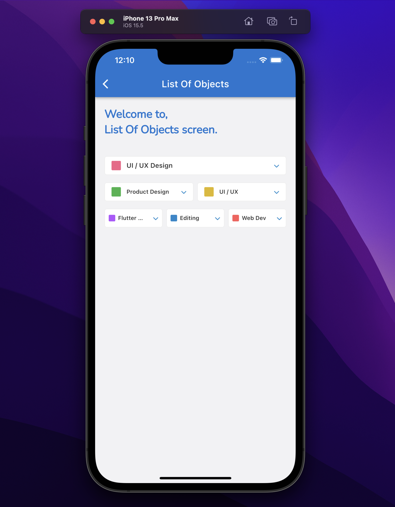

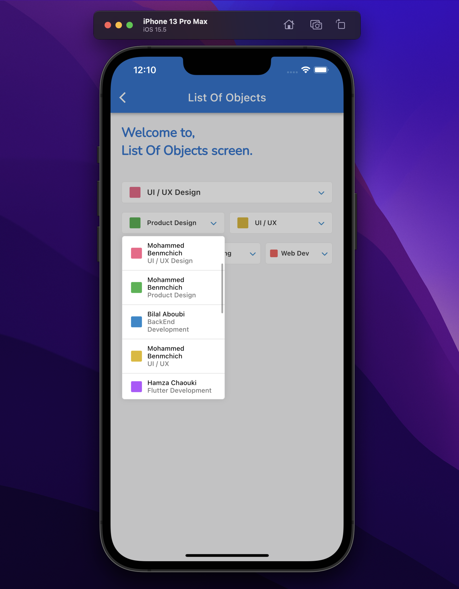
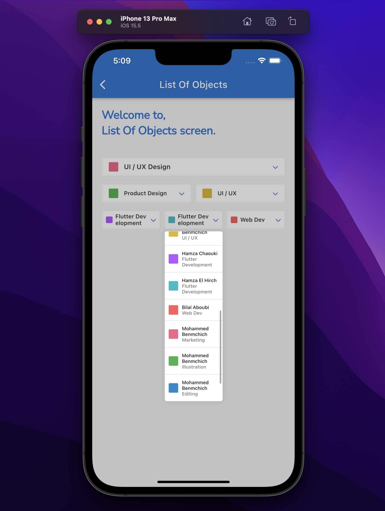

#### General Search for List of Objects
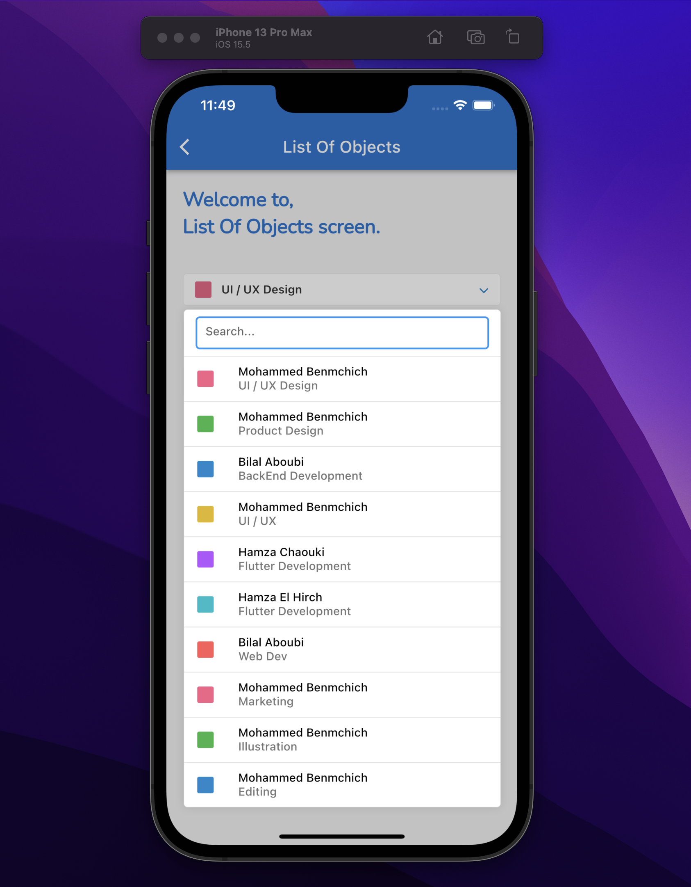
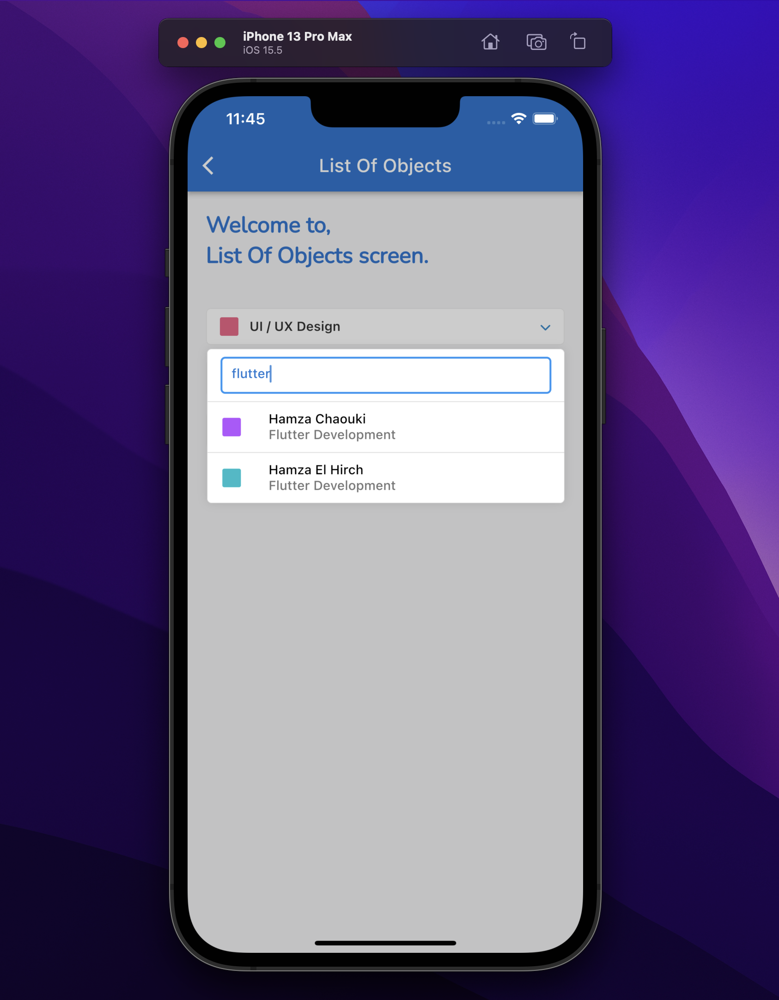


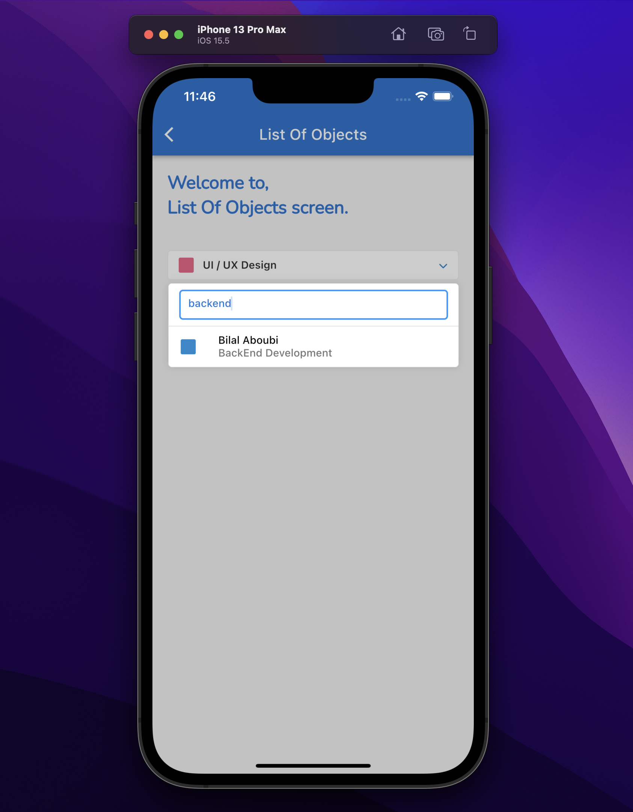

#### List Of Texts / Strings
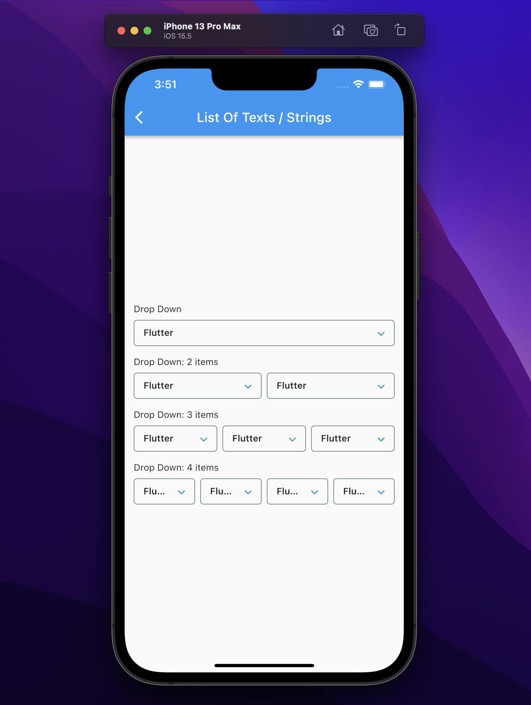
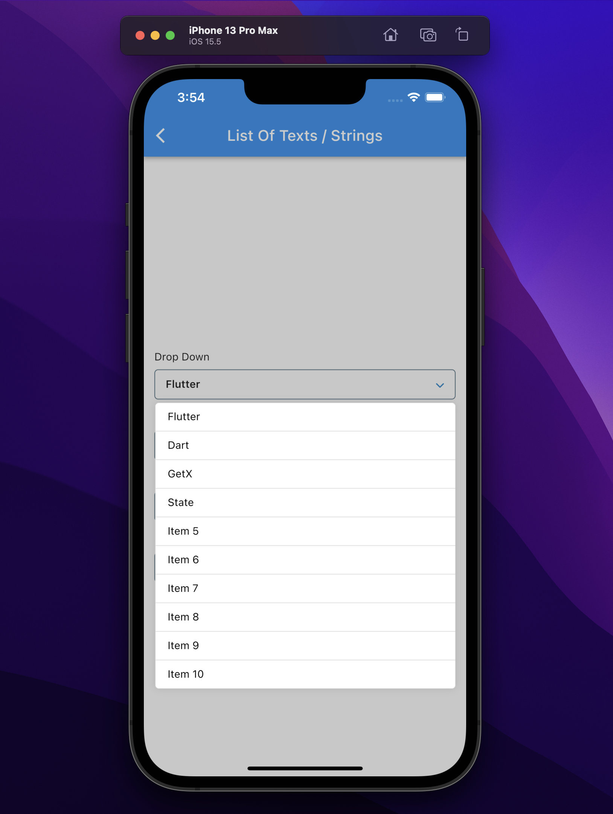
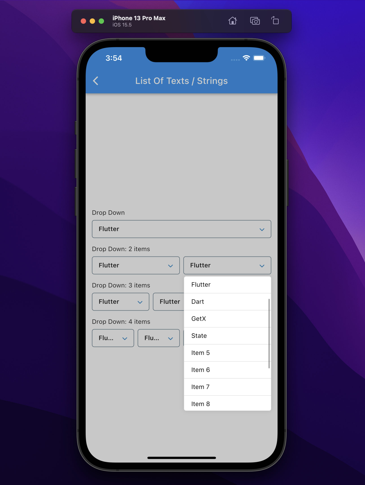
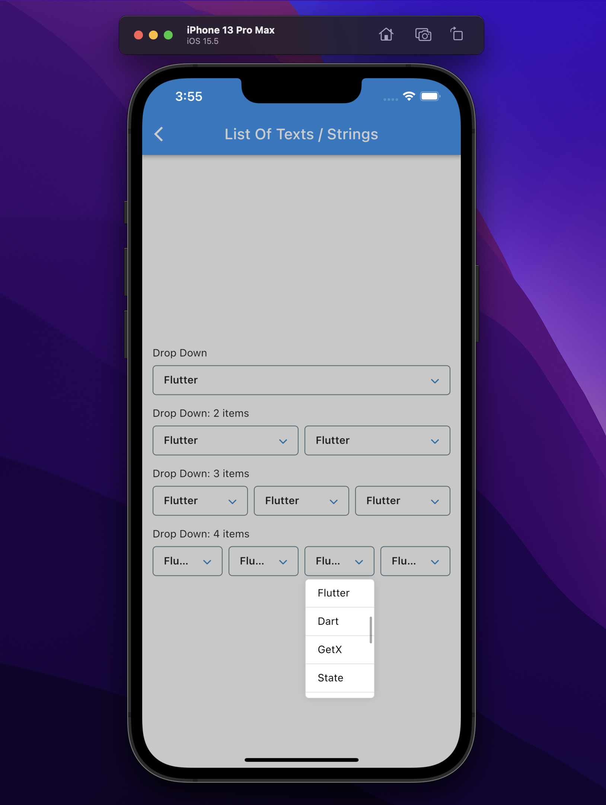
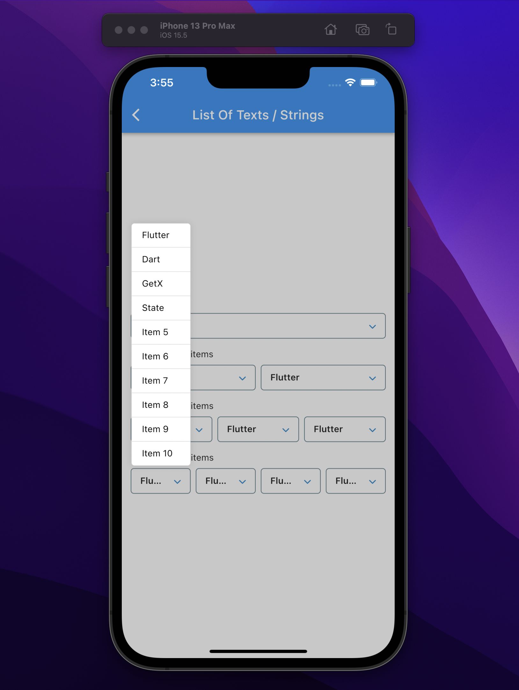

#### Search for List Of Texts / Strings
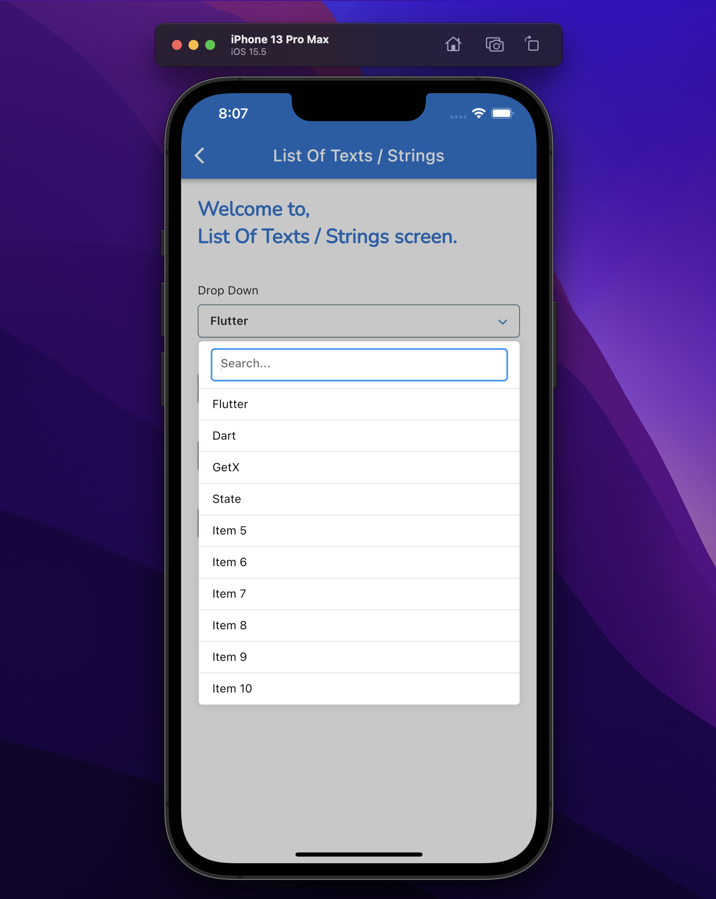
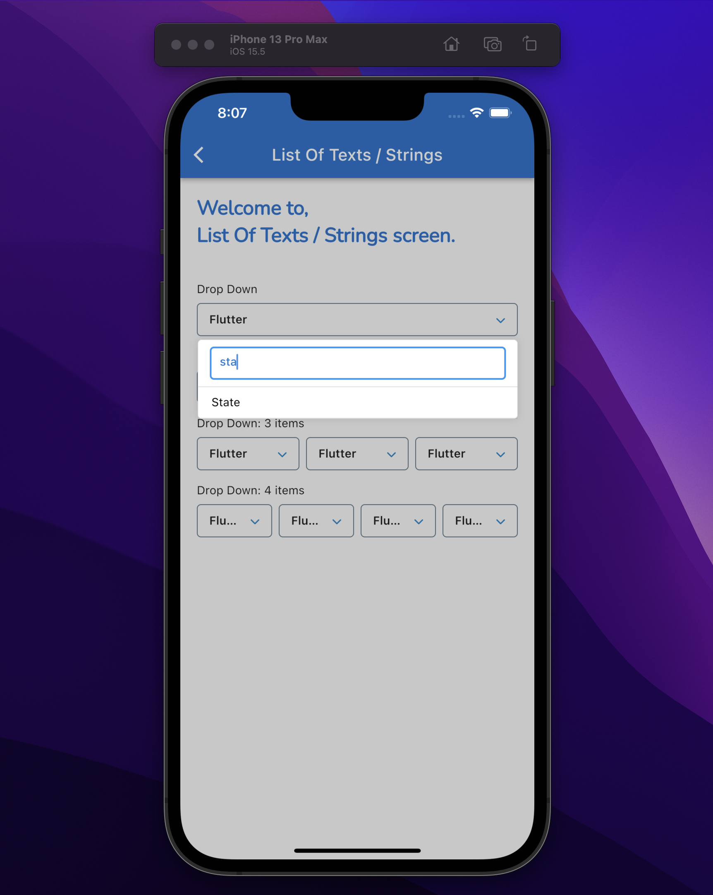

---

## ☕ Support

If `mirai_dropdown_menu` matches your needs, please consider supporting the package:

<a href="https://www.buymeacoffee.com/miraidevs" target="_blank"></a>
